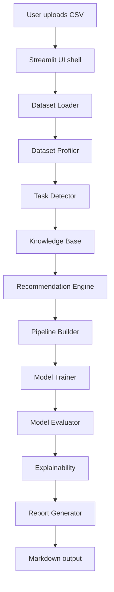
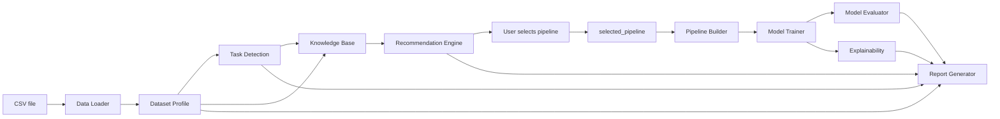

# Project Technical Documentation

## 1. Project Overview

**Project title:** Explainable Machine Learning Pipeline Recommendation System for Tabular Datasets

**Purpose**  
This project implements a thesis prototype that accepts a structured tabular CSV dataset, profiles the data, detects the supervised learning task, recommends a suitable machine learning pipeline, builds and trains the selected pipeline, evaluates it, explains the model output, and generates a final report. The application is intended to support decision making for machine learning pipeline selection while remaining transparent enough for academic discussion.

**Motivation**  
In many practical machine learning workflows, the most difficult part is not fitting a model but deciding which preprocessing steps, algorithms, and evaluation metrics are appropriate for the dataset. This project addresses that problem by making the recommendation process explicit. It also keeps the resulting workflow explainable so that a user can see both why a pipeline was selected and how the trained model behaves.

**Problem statement**  
Tabular datasets often contain missing values, mixed feature types, imbalance, correlated variables, and differing target semantics. These characteristics make pipeline selection non-trivial. A beginner or non-expert user may not know whether the task is classification or regression, what preprocessing is needed, which model family is appropriate, or how to interpret the trained model. The project addresses this by combining profiling, task detection, a declarative knowledge base, pipeline construction, evaluation, explainability, and report generation in one guided workflow.

**Overall objectives**

- Analyze a CSV dataset and profile its structure and quality.
- Detect whether the target corresponds to classification or regression.
- Recommend a ranked set of explainable machine learning pipelines.
- Convert the selected recommendation into an executable scikit-learn / imbalanced-learn pipeline.
- Train and evaluate the chosen pipeline.
- Explain the recommendation rationale and the trained model using feature importance.
- Generate a thesis-friendly Markdown report.

**Intended users**

- Bachelor’s thesis evaluators and supervisors.
- Students learning applied machine learning workflow design.
- Researchers who want a transparent, reproducible recommendation prototype for tabular data.
- Developers who need a reference implementation for a guided ML pipeline assistant.

**Scope**

- Structured tabular CSV input only.
- Single supervised target column chosen by the user.
- Classification and regression tasks.
- Declarative recommendation logic based on a knowledge base.
- Built-in preprocessing, model training, evaluation, explainability, and reporting.

**Limitations**

- Not designed for multi-table relational datasets.
- Not designed for free-text, image, audio, graph, or generic time-series workflows.
- Recommendation logic is rule-based and knowledge-base-driven, not learned from historical training data.
- Explainability uses permutation importance in the automatic workflow; optional manual SHAP is available for supported tree-based models. LIME, counterfactuals, PDP, ICE, and Anchors are not implemented.
- Report generation currently provides Markdown only; PDF export is not implemented in the executable application.
- The application operates primarily through Streamlit session state and is not a multi-user backend service.

## 2. System Architecture

The system is intentionally layered. The Streamlit application layer manages the user interface and session state, the `src/` layer contains the machine learning and report-generation logic, and the `knowledge_base/` directory stores declarative recommendation knowledge in JSON form. The separation is important for thesis defensibility because it keeps recommendation knowledge independent from executable logic.

### 2.1 Architectural Layers

| Layer | Responsibility |
| --- | --- |
| Presentation | Streamlit pages in `app/views/` and app shell in `app/streamlit_app.py` |
| Workflow state | Shared session keys, navigation state, and result objects |
| Domain logic | Loader, profiler, detector, recommender, builder, trainer, evaluator, explainability, report generation |
| Knowledge layer | Declarative pipeline archetypes and rules in `knowledge_base/` |
| Validation layer | Input validation and error handling in each module |

### 2.2 Design Decisions at a High Level

- The project uses a single navigation source instead of Streamlit auto-discovered pages so the workflow can behave like a guided thesis demo rather than a generic multipage app.
- Recommendation logic is rule-based so that every suggested pipeline can be traced back to explicit dataset characteristics and knowledge-base conditions.
- Session state is used to pass structured workflow results between pages without requiring a separate database.
- The report generator consumes the same workflow results that the UI shows, which keeps the final report aligned with the interactive application.
- Optional dependencies such as `xgboost` and `shap` are treated as enhancements rather than hard requirements. `reportlab` is not part of the current report implementation.

### 2.3 Data Flow

## 3. Complete Workflow

### 3.1 Upload Dataset

**Input:** CSV file selected in the Streamlit upload page.  
**Output:** `CSVLoadResult` and a DataFrame stored in session state.  
**Processing:** The loader accepts either a local path or a Streamlit-style uploaded file object, validates that the input is a CSV source, decodes bytes using a fallback strategy, and parses the file into a pandas DataFrame.  
**Design rationale:** Loading is isolated in its own module so the rest of the workflow can work with a clean DataFrame boundary rather than file parsing logic.

### 3.2 Dataset Profiling

**Input:** Uploaded DataFrame.  
**Output:** `DatasetProfileResult` with column summaries, missing values, duplicates, correlations, outliers, sample rows, and target distribution when applicable.  
**Processing:** The profiler computes structural statistics and data-quality indicators. It identifies numeric, categorical, boolean, and datetime columns, counts missing and duplicate rows, computes correlations among numeric features, and detects outliers using the IQR rule.  
**Design rationale:** The recommendation engine needs descriptive evidence about the dataset. The profiler provides that evidence in a structured form.

### 3.3 Task Detection

**Input:** DataFrame and user-selected target column.  
**Output:** `TaskDetectionResult`.  
**Processing:** The task detector applies rule-based heuristics to classify the task as classification or regression. It uses the target type, the number of unique values, and the unique ratio to make the decision.  
**Design rationale:** Supervised task type is a prerequisite for pipeline selection, model construction, and metric selection.

### 3.4 Knowledge Base

**Input:** Declarative JSON files in `knowledge_base/`.  
**Output:** Structured metadata, categories, pipeline archetypes, and rules.  
**Processing:** The knowledge base loader validates JSON schema and converts the content into dataclasses.  
**Design rationale:** Separating the recommendation knowledge into JSON makes the system easier to inspect, revise, and defend academically.

### 3.5 Recommendation Engine

**Input:** `DatasetProfileResult` and `TaskDetectionResult`.  
**Output:** `PipelineRecommendationResult` containing ranked pipeline candidates and supporting evidence.  
**Processing:** The engine combines profile evidence, task evidence, knowledge base archetypes, and declarative rules. It computes confidence, builds preprocessing suggestions, and ranks pipelines.  
**Design rationale:** The system needs explainable recommendations rather than black-box suggestions.

### 3.6 Pipeline Builder

**Input:** Selected `PipelineRecommendation`, profile result, and task result.  
**Output:** `BuiltPipelineResult` containing an executable scikit-learn or imbalanced-learn pipeline.  
**Processing:** The builder maps the recommendation to concrete preprocessing transformers, an estimator, optional PCA, and optional SMOTE.  
**Design rationale:** Recommendation must be translated into a real pipeline before training.

### 3.7 Model Training

**Input:** Built pipeline, dataset, target column, task type.  
**Output:** `TrainingResult`.  
**Processing:** The trainer splits the data into train/test sets, optionally runs cross-validation, fits the pipeline, and records training duration and cross-validation scores.  
**Design rationale:** The training step must remain separate from recommendation and pipeline construction so that each concern is independently testable.

### 3.8 Model Evaluation

**Input:** `TrainingResult`, dataset, target column, task type.  
**Output:** `EvaluationResult`.  
**Processing:** The evaluator predicts on the held-out data and computes task-appropriate metrics. It also produces a qualitative rating and summary.  
**Design rationale:** The project needs a simple, explainable assessment of model performance.

### 3.9 Explainability

**Input:** `TrainingResult`, dataset, target column, task type.  
**Output:** `ExplainabilityResult`.  
**Processing:** The explainability module computes permutation importance on original features and returns ranked feature contributions.  
**Design rationale:** Feature importance offers a global explanation that is easy to present in a bachelor’s thesis.

### 3.10 Report Generation

**Input:** Profile, task, recommendation, training, evaluation, and optional explainability results.  
**Output:** `ReportResult` with Markdown text; `pdf_bytes` remains unavailable in the current implementation.  
**Processing:** The report page passes the explicitly selected recommendation from `st.session_state["selected_pipeline"]` to the report generator. The report uses that recommendation for selected-pipeline information and uses the actual fitted estimator metadata from `TrainingResult` for the trained algorithm.  
**Design rationale:** The report step gives a thesis-friendly final artifact that mirrors the interactive workflow.

## 4. Module Documentation

### 4.1 `src/data_loader.py`

**Purpose**  
Provides a small and explicit CSV-loading boundary.

**Responsibilities**

- Accept CSV files from paths or uploaded-file objects.
- Validate source type and file readability.
- Detect encoding with a fallback strategy.
- Parse CSV content into a DataFrame.
- Return structured results instead of raw exceptions.

**Public API**

- `CSVLoadResult`
- `DatasetLoaderError`
- `UnsupportedFileTypeError`
- `FileNotFoundLoaderError`
- `EmptyFileError`
- `FileReadError`
- `EncodingDetectionError`
- `CSVParseError`
- `load_csv()`
- `load_csv_from_path()`
- `load_csv_from_uploaded_file()`
- `validate_csv_source()`
- `detect_encoding()`
- `read_csv_with_fallback()`
- `build_loader_result()`

**Inputs / outputs**  
Input is either a path or uploaded file object. Output is `CSVLoadResult` containing the DataFrame, row and column counts, file metadata, warnings, and errors.

**Validation and error handling**  
The module checks file type, path existence, empty file content, decode failures, and parser failures. It never exposes pandas parser exceptions directly to the UI.

**Testing**  
Covered by `tests/test_data_loader.py` with success and failure cases, including encoding fallback and malformed CSV handling.

### 4.2 `src/data_profiler.py`

**Purpose**  
Analyzes a DataFrame and produces a structured dataset profile.

**Responsibilities**

- Classify column types.
- Compute missing values and duplicate rows.
- Build per-column summaries.
- Detect high-cardinality categories and highly correlated numeric features.
- Detect IQR outliers.
- Summarize the target distribution when a target is provided.

**Public API**

- `DatasetProfileResult`
- `DatasetProfiler`
- `DatasetProfilerError`
- `InvalidDatasetError`
- `EmptyDatasetError`
- `MissingTargetColumnError`
- `ProfilingComputationError`
- `profile_dataset()`
- `validate_dataset_for_profiling()`

**Important constants**

- `PROFILE_VERSION = "1.0"`
- `MISSING_VALUE_WARNING_THRESHOLD = 0.20`
- `HIGH_CARDINALITY_THRESHOLD = 50`
- `HIGH_CORRELATION_THRESHOLD = 0.80`
- `OUTLIER_IQR_MULTIPLIER = 1.5`
- `LOW_UNIQUE_CLASSIFICATION_THRESHOLD = 20`
- `IMBALANCE_RATIO_WARNING_THRESHOLD = 0.20`
- `SAMPLE_ROW_COUNT = 5`

**Validation and error handling**  
Rejects non-DataFrame input, empty data, and missing target columns. Errors are wrapped into `DatasetProfileResult` so the UI can display them safely.

**Testing**  
Covered by `tests/test_data_profiler.py`, including summary construction, missing values, duplicates, correlations, outliers, and target profiling.

### 4.3 `src/task_detector.py`

**Purpose**  
Determines whether the task is classification or regression.

**Responsibilities**

- Inspect the target column.
- Derive task type heuristically.
- Produce confidence and explanation metadata.

**Public API**

- `TaskDetectionResult`
- `TaskDetector`
- `TaskDetectorError`
- `InvalidInputError`
- `MissingTargetColumnError`
- `EmptyTargetError`
- `TaskDetectionComputationError`
- `detect_task_type()`
- `validate_task_detection_input()`

**Important constants**

- `BINARY_TARGET_UNIQUE_COUNT = 2`
- `LOW_UNIQUE_CLASSIFICATION_THRESHOLD = 20`
- `LOW_UNIQUE_RATIO_THRESHOLD = 0.05`
- `HIGH_UNIQUE_RATIO_REGRESSION_THRESHOLD = 0.20`
- `HIGH_CONFIDENCE = 0.95`
- `MEDIUM_CONFIDENCE = 0.75`
- `LOW_CONFIDENCE = 0.60`

**Validation and error handling**  
The detector validates that the input is a non-empty DataFrame, that the target column exists, and that the target has at least one usable value.

**Testing**  
Covered by `tests/test_task_detector.py` across classification, regression, borderline cases, and error handling.

### 4.4 `src/knowledge_base.py`

**Purpose**  
Loads and validates declarative recommendation knowledge.

**Responsibilities**

- Read JSON metadata, categories, archetypes, and rules.
- Validate schema and data types.
- Convert JSON objects into dataclasses.
- Provide rule lookup and archetype access.

**Public API**

- `KnowledgeBaseMetadata`
- `KnowledgeBaseCategory`
- `KnowledgeBaseCondition`
- `KnowledgeBaseRule`
- `PipelineArchetype`
- `KnowledgeBaseData`
- `KnowledgeBase`
- `KnowledgeBaseError`
- `KnowledgeBaseNotLoadedError`
- `KnowledgeBaseValidationError`
- `KnowledgeBaseFileError`

**Knowledge base files**

- `knowledge_base/metadata.json`
- `knowledge_base/categories.json`
- `knowledge_base/pipeline_archetypes.json`
- `knowledge_base/rules/*.json`

**Validation and error handling**  
The loader checks that all required files exist, that JSON is valid, that lists are non-empty where expected, that rule IDs are unique, and that required categories such as `dimensionality_reduction` and `feature_selection` are present.

**Testing**  
Covered by `tests/test_knowledge_base.py` for schema validation, file errors, duplicate IDs, and load behavior.

### 4.5 `src/recommendation_engine.py`

**Purpose**  
Generates ranked, explainable pipeline recommendations from dataset evidence.

**Responsibilities**

- Build evidence contexts from profile and task detection results.
- Match knowledge-base rules against the evidence.
- Select a representative model family for each archetype.
- Build preprocessing recommendations and explanations.
- Rank pipelines and expose supporting recommendations.

**Public API**

- `SupportingRecommendationItem`
- `PipelineRecommendation`
- `PipelineRecommendationResult`
- `RecommendationEngine`
- `RecommendationEngineError`
- `InvalidRecommendationInputError`
- `RecommendationComputationError`
- `recommend_pipelines()`
- `validate_recommendation_input()`

**Key implementation facts**

- `TOP_PIPELINE_COUNT = 5`
- `SUPPORTED_TASK_TYPES = {"classification", "regression"}`
- Confidence is computed as a weighted combination of task confidence, rule support, and archetype fit.
- Pipelines are ranked by confidence score and then deterministic tie-breakers.
- Supporting rules are sorted by priority, confidence, and rule ID.

**Testing**  
Covered by `tests/test_recommendation_engine.py` and validated after the knowledge base expansion to support Top 5 output.

### 4.6 `src/pipeline_builder.py`

**Purpose**  
Turns a selected recommendation into an executable pipeline.

**Responsibilities**

- Validate upstream recommendation and profile data.
- Build a `ColumnTransformer` for numeric, categorical, and boolean columns.
- Map scaling strategies to concrete scalers.
- Add optional PCA and optional SMOTE.
- Instantiate the selected estimator.

**Public API**

- `BuiltPipelineResult`
- `PipelineBuilder`
- `PipelineBuilderError`
- `InvalidPipelineRecommendationError`
- `UnsupportedModelError`
- `PipelineConstructionError`
- `build_pipeline()`

**Supported preprocessing behaviors**

- Median imputation for numeric features.
- Most-frequent imputation for categorical and boolean features.
- One-hot encoding for categorical features.
- Optional scaling with `StandardScaler`, `MinMaxScaler`, or `RobustScaler`.
- Optional PCA with `n_components=0.95`.
- Optional SMOTE for classification imbalance.

**Supported model families**

- Classification: Logistic Regression, Random Forest Classifier, Decision Tree Classifier, SVC / SVM, KNN, GaussianNB, XGBClassifier.
- Regression: Linear Regression, Ridge, Lasso, Random Forest Regressor, Decision Tree Regressor, SVR, XGBRegressor.

**Validation and error handling**  
Rejects unsupported model families, unsupported scaling strategies, mismatched task types, and invalid upstream results. XGBoost is optional and raises a controlled error when unavailable.

**Testing**  
Covered by `tests/test_pipeline_builder.py`.

### 4.7 `src/model_trainer.py`

**Purpose**  
Fits the executable pipeline on the dataset.

**Responsibilities**

- Validate training inputs.
- Split the data into train/test partitions.
- Optionally run cross-validation.
- Fit the pipeline.
- Record training duration and score statistics.

**Public API**

- `TrainingResult`
- `ModelTrainer`
- `ModelTrainerError`
- `InvalidTrainingInputError`
- `TrainingExecutionError`
- `train_pipeline()`

**Key implementation facts**

- Uses `train_test_split` with `test_size=0.2` and `random_state=42`.
- Uses stratification for safe classification cases.
- Uses `StratifiedKFold` for classification CV and `KFold` for regression CV.
- Scoring metric is `f1_weighted` for classification and `r2` for regression.
- Cross-validation folds are reduced when the dataset is small.

**Testing**  
Covered by `tests/test_model_trainer.py`, including cross-validation behavior, training time, SMOTE pipelines, and failure propagation.

### 4.8 `src/model_evaluator.py`

**Purpose**  
Evaluates a trained pipeline on held-out data.

**Responsibilities**

- Validate evaluation inputs.
- Predict on the dataset.
- Compute task-appropriate metrics.
- Produce a qualitative rating and natural-language summary.

**Public API**

- `EvaluationResult`
- `ModelEvaluator`
- `ModelEvaluatorError`
- `InvalidEvaluationInputError`
- `EvaluationExecutionError`
- `evaluate_model()`

**Key implementation facts**

- Classification metrics: accuracy, weighted precision, weighted recall, weighted F1, confusion matrix.
- Regression metrics: MAE, MSE, RMSE, R2.
- Quality rating thresholds: excellent, good, acceptable, weak.

**Testing**  
Covered by `tests/test_model_evaluator.py`.

### 4.9 `src/explainability.py`

**Purpose**  
Explains the trained model using permutation importance.

**Responsibilities**

- Validate explainability inputs.
- Compute permutation importance on original features.
- Rank influential features.
- Produce a concise explanation summary.

**Public API**

- `ExplainabilityResult`
- `ExplainabilityError`
- `InvalidExplainabilityInputError`
- `ExplainabilityComputationError`
- `explain_model()`

**Key implementation facts**

- Uses `permutation_importance` from scikit-learn.
- Uses `n_repeats=10` and `random_state=42`.
- Uses `f1_weighted` for classification and `r2` for regression scoring.
- Returns top 10 ranked features.
- SHAP is imported defensively but not used as the core method.

**Testing**  
Covered by `tests/test_explainability.py`.

### 4.10 `src/report_generator.py`

**Purpose**  
Builds the final thesis-style report.

**Responsibilities**

- Validate that the required workflow outputs exist and are successful.
- Compose Markdown report sections.
- Accept the explicitly selected recommendation when called from the interactive workflow.
- Describe the actual fitted estimator using the training result.
- Provide a structured `ReportResult` payload.

**Public API**

- `ReportResult`
- `generate_report()`

**Report sections**

- Title
- Dataset Summary
- Task Detection Summary
- Recommended Pipelines
- Training Results
- Evaluation Results
- Explainability Summary
- Limitations
- Conclusion

**Current report behavior**  
The executable application generates and previews Markdown and provides a Markdown download. The `include_pdf` argument and `pdf_bytes` field remain for compatibility, but PDF generation is not implemented and no PDF download is exposed.

**Testing**  
Covered by `tests/test_report_generator.py`.

### 4.11 `src/application_state.py`

**Purpose**  
Defines shared Streamlit session-state helpers.

**Responsibilities**

- Initialize workflow keys.
- Reset workflow state.
- Invalidate downstream results when a selected or trained pipeline becomes obsolete.
- Check workflow completion flags.

**Public API**

- `EXPECTED_SESSION_KEYS`
- `initialize_session_state()`
- `reset_workflow_state()`
- `has_dataset()`
- `has_profile()`
- `has_task_detection()`
- `has_recommendations()`
- `has_training_result()`
- `has_evaluation_result()`

**Note**  
The Streamlit shell adds `report_result` and `current_page` to its own session-state key set, while this module holds the shared workflow state keys used by the pages.

**Testing**  
Covered by `tests/test_application_state.py`.

### 4.12 `app/streamlit_app.py`

**Purpose**  
Serves as the Streamlit application shell and navigation manager.

**Responsibilities**

- Set the app title, icon, and page layout.
- Initialize app-specific session keys.
- Provide sidebar navigation and workflow progress.
- Route to the selected page renderer.
- Define shared UI helpers for wrapped tables.

**Public API**

- `APP_TITLE`
- `APP_SUBTITLE`
- `APP_ICON`
- `APP_SESSION_KEYS`
- `PAGE_ORDER`
- `WORKFLOW_PROGRESS_STEPS`
- `PAGE_REQUIREMENTS`
- `initialize_session_state()`
- `render_header()`
- `render_wrapped_table()`
- `render_wrapped_key_value_table()`
- `render_workflow_progress()`
- `render_sidebar_status()`
- `render_navigation_footer()`
- `main()`

**Design note**  
This module also injects CSS for wrapped tables so the page views can preserve a table layout without truncating long text.

**Testing**  
Covered by `tests/test_streamlit_app_structure.py` and manual startup validation.

### 4.13 Streamlit page modules in `app/views/`

Each page module exposes a single `render()` function. The page modules are:

- `home.py`
- `upload_dataset.py`
- `dataset_profile.py`
- `task_detection.py`
- `recommendations.py`
- `training.py`
- `evaluation.py`
- `explainability.py`
- `report.py`

Their responsibility is presentation only. They read and write Streamlit session state, call the relevant backend module, and render results in a thesis-friendly way.

## 5. Recommendation Engine

The recommendation engine is the central decision-support component of the project. It is not a learned recommender; it is a deterministic, explainable engine built from a declarative knowledge base and explicit scoring logic.

### 5.1 How recommendations are generated

1. The dataset profile and task detection results are validated.
2. A flat evidence context is built from both results.
3. The knowledge base is loaded and filtered to archetypes that match the task type.
4. For each archetype, the engine selects a representative model family.
5. The engine matches declarative rules against the evidence context.
6. The engine computes confidence from task confidence, rule support, and archetype fit.
7. The engine constructs a pipeline recommendation with preprocessing, model family, metrics, explanation, evidence, advantages, and limitations.
8. The engine ranks all pipelines and returns the top five.

### 5.2 Rule-based reasoning

Rule matching happens in `_match_rules()` and `_condition_matches()`. Rules are loaded from JSON and are evaluated against a simple evidence context. Conditions support equality and numeric comparisons. This keeps the logic transparent because each rule can be read directly from the JSON files.

### 5.3 Knowledge base usage

The engine uses:

- `PipelineArchetype` entries to define the shape of a candidate pipeline.
- `KnowledgeBaseRule` entries to provide evidence-backed recommendations.
- `KnowledgeBaseCategory` and metadata to organize the rule set.

The knowledge base currently contains 10 pipeline archetypes and 11 categories, including imputation, encoding, scaling, imbalance handling, dimensionality reduction, feature selection, model-family selection for classification and regression, evaluation metrics, and cross-validation.

### 5.4 Confidence calculation

The confidence score for a pipeline is computed as a weighted blend:

- 40% task confidence
- 35% average confidence of matched supporting rules
- 25% archetype fit score

The final value is clamped to the range $[0, 1]$.

### 5.5 Pipeline ranking

Pipelines are ranked by confidence score, with deterministic tie-breaking by pipeline name. After ranking, the engine renumbers the pipelines so the final payload contains clean rank values starting at 1.

### 5.6 Top 5 recommendation generation

`TOP_PIPELINE_COUNT` is set to 5. This gives the user a compact but useful set of alternatives without overwhelming the page. In the thesis context, five recommendations provide enough diversity to compare trade-offs while still keeping the recommendation list readable.

### 5.7 Pipeline metadata

Each `PipelineRecommendation` includes:

- pipeline name
- task type
- preprocessing steps
- encoding strategy
- scaling strategy
- missing-value strategy
- imbalance strategy
- dimensionality reduction strategy
- recommended model family
- evaluation metrics
- cross-validation recommendation
- confidence score
- explanation
- evidence
- advantages
- limitations
- estimated training complexity
- supporting rule IDs

### 5.8 Explainability support

The engine stores both a human-readable explanation and a list of evidence strings. This makes the recommendation explainable at the pipeline level before model training begins.

## 6. Machine Learning Pipelines

The knowledge base defines pipeline archetypes, while the pipeline builder instantiates concrete estimators. The current project supports both classification and regression.

### 6.1 Classification pipelines

| Model family | Why supported | Advantages | Limitations | Typical preprocessing |
| --- | --- | --- | --- | --- |
| Logistic Regression | Strong interpretability and baseline behavior | Fast, transparent, easy to explain | Less flexible for nonlinear data | Imputation, encoding, scaling |
| Random Forest Classifier | Robust tree-based baseline for mixed features | Handles nonlinear patterns, less sensitive to feature scaling | Less interpretable than linear models | Imputation, encoding, optional scaling |
| Decision Tree Classifier | Simple nonlinear baseline | Easy to visualize conceptually | Can overfit and be unstable | Imputation, encoding, optional scaling |
| SVM / SVC | Margin-based classifier for structured data | Effective on smaller or well-scaled data | Sensitive to preprocessing and tuning | Imputation, encoding, scaling |
| KNN | Simple local-pattern classifier | Intuitive and beginner-friendly | Sensitive to scale and dataset size | Imputation, encoding, scaling |
| GaussianNB | Fast probabilistic baseline | Very fast, simple to explain | Assumes conditional independence | Imputation, encoding |
| XGBoost Classifier | Optional high-capacity classifier | Strong performance on many tabular problems | Requires optional dependency and more tuning | Imputation, encoding, optional scaling |

### 6.2 Regression pipelines

| Model family | Why supported | Advantages | Limitations | Typical preprocessing |
| --- | --- | --- | --- | --- |
| Linear Regression | Transparent baseline | Simple and explainable | May underfit nonlinear relationships | Imputation, encoding, scaling |
| Ridge | Regularized linear regression | Handles correlated predictors well | Less flexible than nonlinear models | Imputation, encoding, scaling |
| Lasso | Sparse linear regression | Can shrink irrelevant coefficients | Sensitive to scaling and tuning | Imputation, encoding, scaling, feature selection |
| Random Forest Regressor | Flexible nonlinear ensemble | Handles mixed and nonlinear patterns | Less interpretable | Imputation, encoding, optional scaling |
| Decision Tree Regressor | Simple nonlinear regressor | Easy to explain conceptually | Can overfit | Imputation, encoding, optional scaling |
| SVR | Margin-based regression | Works well on some nonlinear tabular problems | Sensitive to preprocessing and scale | Imputation, encoding, scaling |
| XGBoost Regressor | Optional high-capacity regressor | Strong performance potential | Requires optional dependency and tuning | Imputation, encoding, optional scaling |

### 6.3 Recommended model selection in the current engine

The recommendation engine does not return every possible model family for every dataset. Instead, it selects one representative model family per archetype. For example:

- Balanced linear classification tends toward Logistic Regression.
- Robust classification archetypes tend toward Random Forest.
- KNN archetypes use KNN.
- Naive Bayes archetypes use GaussianNB.
- Balanced linear regression uses Linear Regression.
- Robust tree regression uses Random Forest Regressor.
- Regularized regression uses Ridge.

This is deliberate: the recommendation system is meant to guide a user toward a readable set of alternatives rather than a long exhaustive list.

## 7. Data Preprocessing

### 7.1 Missing values

Missing values are handled by the pipeline builder using median imputation for numeric features and most-frequent imputation for categorical and boolean features. The recommendation engine surfaces this as a preprocessing recommendation, and the builder translates it into concrete `SimpleImputer` steps.

### 7.2 Categorical encoding

Categorical features are encoded using one-hot encoding. This is a standard and thesis-friendly choice because it is simple to explain, works with many tabular models, and avoids assuming ordinal relationships among categories.

### 7.3 Scaling

Scaling is added when the selected model family benefits from numeric normalization. The builder can instantiate `StandardScaler`, `MinMaxScaler`, or `RobustScaler`, while the recommendation engine describes the scaling strategy in human-readable form. Scaling is especially relevant for linear models, SVM, and KNN.

### 7.4 Feature selection

The current workflow supports feature selection as a knowledge-base concept and as part of regularized regression reasoning. In the builder, feature selection is not a separate automatic transformer in the current implementation; instead, the recommendation metadata can describe it as a strategy when it is conceptually appropriate.

### 7.5 PCA

PCA is optionally inserted into the pipeline when the recommendation calls for dimensionality reduction. In the builder, this is represented by `PCA(n_components=0.95)`. The goal is not to over-automate dimensionality reduction, but to make it available when the recommendation explicitly suggests it.

### 7.6 SMOTE

SMOTE is available for classification pipelines when the recommendation calls for imbalance handling. The builder inserts SMOTE inside the training pipeline so oversampling occurs on the training data rather than the full dataset. This is the correct location because it avoids contaminating the held-out evaluation split.

### 7.7 Cross-validation

Cross-validation is handled in the trainer, not in the builder. Classification uses stratified folds when possible, regression uses ordinary K-fold, and the number of folds is reduced when the dataset is too small.

## 8. Explainability

The system is explainable at two levels.

### 8.1 Pipeline explainability

Pipeline explainability answers the question: **Why was this pipeline recommended?**

The recommendation engine provides explicit reasoning through:

- dataset shape and feature composition
- missing-value patterns
- class imbalance information
- task type
- selected model family
- supporting knowledge-base rules
- model-specific preprocessing rationale

The Recommendations and Explainability pages reuse these existing recommendation outputs and present them as readable reasons. The interactive report receives the selected recommendation explicitly rather than silently substituting the first-ranked candidate.

### 8.2 Model explainability

Model explainability answers the question: **Which features influenced the trained model most?**

The current implementation uses permutation importance from scikit-learn. It ranks original input features by the change in model score when each feature is perturbed. The output is then rendered as:

- a bar chart
- a ranked table of influential features
- a concise plain-English interpretation

### 8.3 Current implementation

The current explainability page presents:

- a model summary card
- pipeline recommendation reasons
- a top influential features chart
- a ranked importance table with influence levels
- a short interpretation paragraph
- a final summary explaining the two-level explainability design

When Explainability is regenerated, the current training and evaluation results are preserved. The previous report and optional SHAP artifacts are invalidated because they depend on the prior explanation state.

### 8.4 Limitations

- Only permutation importance is implemented in the main workflow.
- No local explanation methods are implemented.
- No counterfactual explanation methods are implemented.
- Optional SHAP is manually requested for supported tree-based models. It is not part of the automatic core explanation and is not included in the Markdown report.

### 8.5 Future improvements

- Add SHAP explanations for model-specific interpretability when appropriate.
- Add local explanations for individual predictions.
- Add example-based explanations or counterfactuals if thesis scope expands.

## 9. Report Generation

### 9.1 Markdown generation

`generate_report()` in `src/report_generator.py` combines workflow outputs into a structured Markdown document. The generated sections are ordered and thesis-oriented. The Markdown version is always available when report generation succeeds.

### 9.2 PDF generation

PDF generation is not implemented in the current executable application. The report generator preserves the `include_pdf` argument and `pdf_bytes` result field for compatibility, but the report page provides Markdown preview and download only.

### 9.3 Report sections and data sources

| Section | Source |
| --- | --- |
| Dataset Summary | `DatasetProfileResult` |
| Task Detection Summary | `TaskDetectionResult` |
| Selected Pipeline | Explicit `selected_pipeline` passed from Streamlit session state |
| Recommended Pipelines | `PipelineRecommendationResult` |
| Training Results | `TrainingResult` |
| Evaluation Results | `EvaluationResult` |
| Explainability Summary | `ExplainabilityResult` |
| Limitations | Static report text |
| Conclusion | Evaluation result and workflow context |

Recommendation-level report information comes from the explicitly selected `PipelineRecommendation`: its pipeline name, recommended model family, rationale, recommended preprocessing, advantages, and limitations. Actual trained-model information comes from `TrainingResult`, including the fitted estimator class, hyperparameters, training time, cross-validation results, and executed pipeline steps. Evaluation and explainability sections use their current result objects rather than recommendation metadata.

### 9.4 Report workflow

1. The user completes the earlier workflow steps and selects a pipeline.
2. The report page validates the selected pipeline, built pipeline, training result, and evaluation result.
3. The user clicks `Generate Markdown Report`.
4. The backend receives the selected recommendation explicitly and combines it with the current training, evaluation, and explainability results.
5. The UI shows a Markdown preview and download button.

When the selected pipeline changes, built/training/evaluation/explainability/report artifacts are invalidated. Retraining clears results derived from the previous training run. Regenerating evaluation clears evaluation-dependent artifacts. Regenerating Explainability preserves evaluation and training while clearing report and SHAP artifacts.

## 10. User Interface

The UI is implemented as a guided thesis demo rather than a general-purpose multipage app.

### 10.1 Home

Introduces the project, supported dataset type, data-quality capabilities, workflow, limitations, technologies, and how to start.

### 10.2 Upload Dataset

Lets the user upload a CSV file, clears previous workflow state when requested, loads the dataset, and shows a small dataset summary and preview.

### 10.3 Dataset Profile

Shows dataset-level overview metrics and generates the profile result. It displays column types, missing values, duplicates, high correlations, outliers, target distribution, and sample rows.

### 10.4 Task Detection

Lets the user select the target column and run task detection. It shows the target distribution and the task detection summary.

### 10.5 Recommendations

Shows the top five pipeline recommendations, their rationale, and a selectable summary of the currently chosen pipeline. This page is one of the main decision-support views in the system.

### 10.6 Training

Shows the selected pipeline summary, preprocessing steps, and training results after fitting the pipeline.

### 10.7 Evaluation

Shows the held-out evaluation metrics and quality summary.

### 10.8 Explainability

Shows the two-level explainability story: why the pipeline was selected and which features mattered most in the trained model.

### 10.9 Report

Generates the final thesis-style report, previews the Markdown, and provides a Markdown download action.

### 10.10 UI design notes

- The UI remains academically simple.
- Tables are preserved where they are useful.
- Wrapped table rendering is used so long text remains readable.
- The sidebar provides a single navigation path and workflow progress.
- The app avoids unnecessary visual complexity.

## 11. Technologies

| Technology | Role in the project |
| --- | --- |
| Python | Primary implementation language |
| Streamlit | Interactive UI framework and app shell |
| Pandas | Data loading, profiling, tabular display, and transformation support |
| NumPy | Numeric score and metric calculations |
| scikit-learn | Core ML pipelines, preprocessing, metrics, permutation importance, and CV |
| imbalanced-learn | SMOTE and imbalanced pipeline support |
| XGBoost | Optional high-capacity estimators for tabular classification and regression |
| SHAP | Optional dependency for manually requested tree-model explanations; not the automatic core method |
| Matplotlib | Charting dependency listed in requirements and available for plotting support |
| Plotly | Charting dependency listed in requirements and available for interactive visualization support |
| Pytest | Unit testing framework |
| Joblib | Declared dependency for model persistence support in the project environment |
| SciPy | Declared dependency supporting the scientific Python stack |
| OpenPyXL | Declared dependency for spreadsheet compatibility in the project environment |
| Seaborn | Declared plotting dependency in the project environment |
| python-dotenv | Declared environment configuration dependency |

The core workflow relies primarily on Python, Streamlit, pandas, NumPy, scikit-learn, imbalanced-learn, Pytest, and the optional libraries that support extension features.

## 12. Project Structure

| Folder / file | Purpose |
| --- | --- |
| `app/` | Streamlit application shell and page renderers |
| `app/streamlit_app.py` | Central navigation, session state, shared table helpers, and app entry point |
| `app/views/` | Individual Streamlit page modules |
| `src/` | Machine learning, knowledge-base, explainability, and report logic |
| `knowledge_base/` | Declarative recommendation knowledge in JSON form |
| `tests/` | Unit test suite |
| `datasets/` | Working area for datasets used during development |
| `models/` | Intended storage for trained models or model artifacts; ignored in git |
| `outputs/` | Intended storage for generated outputs; ignored in git |
| `docs/` | Thesis-related reference materials; ignored in git |
| `reference/` | Reference notebooks and prior assignment material; ignored in git |
| `README.md` | Project entry documentation |
| `requirements.txt` | Runtime and development dependency list |
| `pyproject.toml` | Project metadata and tool configuration |

### `.gitignore` behavior

The repository ignores:

- `thesis_env/` and `.venv/`
- Python cache files
- Jupyter checkpoint files
- `.vscode/`
- `.env`
- log files
- `models/` and `outputs/`
- temporary files
- `docs/` and `reference/`

This means that the repository intentionally keeps generated and reference materials out of version control.

## 13. Testing

### 13.1 Testing strategy

The project uses unit tests for all major modules and for the Streamlit application structure. The goal is to test each module independently and verify that the workflow remains stable as the application evolves.

### 13.2 Unit testing

The test suite includes dedicated files for:

- application state
- data loader
- dataset profiler
- task detector
- knowledge base
- recommendation engine
- pipeline builder
- model trainer
- model evaluator
- explainability
- report generator
- Streamlit app structure

### 13.3 Pytest

Pytest is configured in `pyproject.toml` with `testpaths = ["tests"]` and `pythonpath = ["."]`.

### 13.4 Test count

The current full suite contains **131 passing tests**.

### 13.5 Coverage

A formal coverage percentage is not published by the repository tooling in the current setup. Instead, the project relies on a broad set of targeted unit tests that exercise the major workflow components and their error handling paths.

### 13.6 Validation datasets

The tests use small synthetic tabular datasets that are designed to exercise classification and regression paths without external dependencies.

### 13.7 Manual testing

The project has also been manually validated with:

- `python -m pytest -v`
- `streamlit run app/streamlit_app.py`

Both commands completed successfully in the current state of the repository.

## 14. Public APIs

### 14.1 Backend modules

| Module | Public API surface |
| --- | --- |
| `src/data_loader.py` | `CSVLoadResult`, loader exceptions, `load_csv()`, `load_csv_from_path()`, `load_csv_from_uploaded_file()`, `validate_csv_source()`, `detect_encoding()`, `read_csv_with_fallback()`, `build_loader_result()` |
| `src/data_profiler.py` | `DatasetProfileResult`, profiler exceptions, `DatasetProfiler`, `profile_dataset()`, `validate_dataset_for_profiling()` |
| `src/task_detector.py` | `TaskDetectionResult`, detector exceptions, `TaskDetector`, `detect_task_type()`, `validate_task_detection_input()` |
| `src/knowledge_base.py` | Knowledge-base dataclasses, `KnowledgeBase`, knowledge-base exceptions |
| `src/recommendation_engine.py` | Recommendation dataclasses, engine exceptions, `RecommendationEngine`, `recommend_pipelines()`, `validate_recommendation_input()` |
| `src/pipeline_builder.py` | `BuiltPipelineResult`, builder exceptions, `PipelineBuilder`, `build_pipeline()` |
| `src/model_trainer.py` | `TrainingResult`, trainer exceptions, `ModelTrainer`, `train_pipeline()` |
| `src/model_evaluator.py` | `EvaluationResult`, evaluator exceptions, `ModelEvaluator`, `evaluate_model()` |
| `src/explainability.py` | `ExplainabilityResult`, explainability exceptions, `explain_model()` |
| `src/report_generator.py` | `ReportResult`, `generate_report()` |
| `src/application_state.py` | session-key constant and workflow-state helper functions |

### 14.2 Streamlit shell and pages

| Module | Public API surface |
| --- | --- |
| `app/streamlit_app.py` | app constants, session-state helpers, shared table helpers, navigation helpers, `main()` |
| `app/views/home.py` | `render()` |
| `app/views/upload_dataset.py` | `render()` |
| `app/views/dataset_profile.py` | `render()` |
| `app/views/task_detection.py` | `render()` |
| `app/views/recommendations.py` | `render()` |
| `app/views/training.py` | `render()` |
| `app/views/evaluation.py` | `render()` |
| `app/views/explainability.py` | `render()` |
| `app/views/report.py` | `render()` |

## 15. Configuration

### 15.1 `requirements.txt`

The requirements file lists the runtime and development dependencies used by the project, including the core ML stack and optional extension packages.

### 15.2 `pyproject.toml`

This file stores project metadata and tool configuration:

- project name, version, description, and author
- pytest test paths and import path configuration
- Black line length configuration
- Ruff line length configuration

### 15.3 `.gitignore`

The `.gitignore` file excludes virtual environments, caches, editor settings, generated artifacts, and thesis reference material.

### 15.4 Application configuration

The Streamlit shell defines:

- application title, subtitle, and icon
- session-state keys
- page order
- workflow progress steps
- page prerequisites
- shared UI helpers for navigation and wrapped tables

The knowledge base also carries its own metadata versioning in `knowledge_base/metadata.json`.

## 16. Design Decisions

| Decision | Reasoning |
| --- | --- |
| Rule-based recommendation | Makes the pipeline choice transparent and defensible in a thesis setting |
| Streamlit UI | Provides a quick, interactive, low-overhead thesis demo environment |
| Knowledge base in JSON | Separates domain knowledge from executable code and makes updates explicit |
| Logistic Regression baseline | Offers a simple, interpretable, and academically defensible baseline |
| Top 5 recommendations | Balances choice diversity with readability |
| Markdown reports | Produces a thesis-friendly artifact that is easy to inspect and export |
| Permutation importance | Provides a practical model explainability method without introducing heavy complexity |
| Session-state workflow | Keeps the multi-step UI stateful without requiring a separate backend |
| Wrapped table helper | Preserves table layout while preventing long-text truncation in Streamlit |

### Why SHAP?

SHAP is an optional dependency used by a manually triggered Explainability-page action for supported tree-based models. It is not part of the automatic core explainability result and is not included in the Markdown report. Permutation importance remains the primary explainability method.

## 17. Known Limitations

- Only structured CSV/tabular input is supported.
- Only one target column is used at a time.
- The recommendation logic is knowledge-based rather than data-driven from historical performance logs.
- The system does not implement LIME, counterfactual explanations, PDP, ICE, or Anchors.
- The current explainability implementation is global rather than local.
- Models are not persisted as a formal model registry in the current workflow.
- Report generation currently supports Markdown only; PDF export is not implemented.
- The system is not designed for authenticated multi-user deployment.
- The project does not include domain-specific dataset adapters beyond CSV input.

## 18. Future Improvements

- Add more pipeline archetypes and rule coverage for broader dataset patterns.
- Add SHAP-based explanations as an optional second explainability method.
- Add local explanation support for individual predictions.
- Add persistent model storage and versioned artifacts.
- Add experiment tracking for reproducible comparison of pipelines.
- Add richer PDF styling and report branding.
- Add dataset import from URLs or cloud storage.
- Add more robust support for imbalanced and high-dimensional datasets.
- Add automated coverage reporting to the test pipeline.
- Add a lightweight user authentication layer if the app is deployed for multiple users.

## 19. Thesis Contributions

This project contributes academically in a limited but meaningful way.

### Decision support

The system shows how a machine learning pipeline can be recommended from explicit dataset characteristics rather than by manual guesswork. This is useful as a decision-support prototype for beginners.

### Explainable recommendation

The recommendation engine does not simply output a model name. It also returns evidence, supporting rules, preprocessing suggestions, and confidence values. That makes the recommendation process inspectable and discussable.

### Transparent ML workflow

The project demonstrates a complete supervised-learning workflow: profiling, task detection, recommendation, pipeline assembly, training, evaluation, explainability, and reporting. Each phase is separated into its own module and can be studied independently.

### Educational value

The implementation is intentionally beginner-friendly and structured so that the workflow can be explained during a bachelor’s thesis defense. It is therefore useful as an educational example of end-to-end ML system design.

## 20. Appendix

### 20.1 Dataclasses

- `CSVLoadResult`
- `DatasetProfileResult`
- `TaskDetectionResult`
- `KnowledgeBaseMetadata`
- `KnowledgeBaseCategory`
- `KnowledgeBaseCondition`
- `KnowledgeBaseRule`
- `PipelineArchetype`
- `KnowledgeBaseData`
- `SupportingRecommendationItem`
- `PipelineRecommendation`
- `PipelineRecommendationResult`
- `BuiltPipelineResult`
- `TrainingResult`
- `EvaluationResult`
- `ExplainabilityResult`
- `ReportResult`

### 20.2 Enums

No Enum types are currently defined in the codebase.

### 20.3 Configuration constants

Key constants include:

- `PROFILE_VERSION`
- `ENGINE_VERSION`
- `TOP_PIPELINE_COUNT`
- `SUPPORTED_TASK_TYPES`
- `APP_TITLE`
- `APP_SUBTITLE`
- `APP_ICON`
- `APP_SESSION_KEYS`
- `PAGE_ORDER`
- `WORKFLOW_PROGRESS_STEPS`
- `PAGE_REQUIREMENTS`
- loader, profiler, and detector thresholds

### 20.4 Knowledge base JSON files

- `knowledge_base/metadata.json`
- `knowledge_base/categories.json`
- `knowledge_base/pipeline_archetypes.json`
- `knowledge_base/rules/imputation_rules.json`
- `knowledge_base/rules/encoding_rules.json`
- `knowledge_base/rules/scaling_rules.json`
- `knowledge_base/rules/imbalance_rules.json`
- `knowledge_base/rules/dimensionality_rules.json`
- `knowledge_base/rules/classification_model_rules.json`
- `knowledge_base/rules/regression_model_rules.json`
- `knowledge_base/rules/evaluation_metric_rules.json`
- `knowledge_base/rules/cross_validation_rules.json`
- `knowledge_base/rules/dimensionality_rules.json` also contains the `feature_selection` rule category in the current codebase.

### 20.5 Pipeline definitions

The repository defines the following archetype families in `knowledge_base/pipeline_archetypes.json`:

- Balanced Linear Classification Pipeline
- Robust Tree Classification Pipeline
- Imbalanced Classification Pipeline
- KNN Classification Pipeline
- Naive Bayes Classification Pipeline
- Balanced Linear Regression Pipeline
- Support Vector Regression Pipeline
- Random Forest Regression Pipeline
- Robust Tree Regression Pipeline
- Regularized Regression Pipeline

These archetypes are the declarative backbone of the recommendation engine.

---

## Closing Note

This document describes the current implementation state of the repository as an explainable machine learning pipeline recommendation prototype for tabular datasets. It is intended to be used as the primary technical reference for thesis writing and code comprehension.